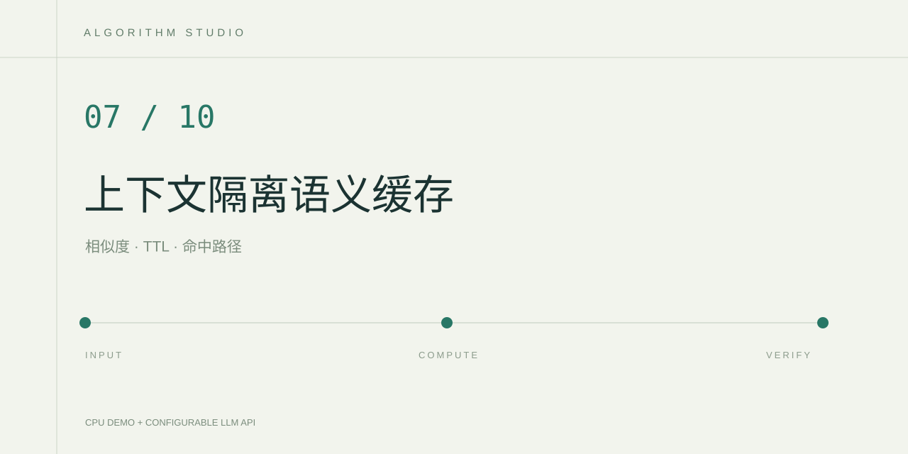

# ContextCache 语义缓存实验室

用户提问时先查询持久缓存，命中后复用历史回答，未命中时才调用云端模型。页面展示精确命中、相似命中、未命中、候选问题和请求轨迹。

## 实现

- SQLite 保存问题、回答、过期时间。参数绑定和主键约束确保写入可重试。
- 上下文版本、demo/live 模式、API 地址、模型名、提示策略版本共同构成 SHA-256 隔离空间。
- NFKC、大小写和空白归一化后先精确匹配。
- 相似匹配使用字符 1～3 gram TF-IDF 和余弦相似度，阈值为 0.88。这是词法相似度近似，并没有使用 embedding 语义模型。
- 数字、否定词和可识别设备编号变化时拒绝相似复用。
- 缓存 TTL 为 3,600 秒，查询排除过期条目，每个隔离空间最多读取最近 500 条有效候选。

## 在 PyCharm 运行

使用 Python 3.12 环境，安装本目录的 requirements.txt。右键运行 app.py，浏览器打开运行窗口显示的地址。默认本地演示，使用项目自撰的设备维护学习样例，不产生模型费用。

输入格式为 `maintenance-v1 || 轴承温度超过阈值时应该如何处理？`。第一次尝试样例可观察精确命中。改写问题观察候选分数，改变左侧版本观察空间隔离。第二次提交相同新问题会命中第一次生成的缓存。

云端模式从本目录 .env 读取 LLM_API_KEY、LLM_BASE_URL、LLM_MODEL。缓存 miss 才调用模型，演示缓存不会被云端模式读取。`.cache/` 内保存实际问题和回答，发布仓库时使用随附忽略规则排除它。

## 验证

在 PyCharm 测试运行配置中选择 tests 目录，或在项目目录运行 `python -m unittest discover -s tests`。

测试覆盖过期边界、版本/模式/模型/API 隔离、相似命中、数字变化、否定变化和设备编号变化。可以自行建立带预期可复用标签的问题对，报告命中率、误复用率和真实 API 调用次数。项目未预填云端准确率或费用节省比例。

## 边界

相似问题不一定共享正确答案，当前规则也无法识别所有实体与语义变化。上下文版本需要调用方正确更新。TTL 查询过滤不会自动删除旧记录。高风险业务应使用更严格的匹配和人工核对。

## 参考

- [scikit-learn TF-IDF](https://scikit-learn.org/stable/modules/generated/sklearn.feature_extraction.text.TfidfVectorizer.html)
- [Python sqlite3](https://docs.python.org/3/library/sqlite3.html)

## 可以继续完成的实验

在固定问题对上对比字符 TF-IDF 和本地 embedding，选择验证集阈值，保留独立测试集。记录一次 miss 和一次 hit 的真实端到端时延，并同时报告误复用情况。
